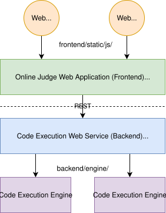

= Vygoj: Vygotsky Online Juge

**VygOJ**, Vygotsky Online Juge, is an educative tool designed to support software requirements derived from Socialcultural Constructivism theory. Vygoj combines features from other tools such as Online Programming Judges (OJ), Learning Management Systems (LMS), and Massive Open Online Courses (MOOC). As a distintive feature, Vygoj supports the concurrent programming paradigm.

An *online programming judge* is a software that provides "verdicts" about the correctness and efficiency of other computer programs generated by using software testing. Vygoj is an online judge for educative goals that support the concurrent programming paradigm. Other online judges are designed for competitive programming and recruiting. This online judge is compound of three modules:

[#fig_architecture]
.Software architecture

Users are teachers, students, and administrators. They use a _web browser_ to access the *Online Judge Web Application* module, namely *frontend* for short. This module is a web server developed in Node.js (being migrated to Python/Flask) and its source code is the `app/` directory.

The web application does not run code from users. It captures that code and passes it to the *Code Execution Service*, called *backend* for short. This is a web service that executes code in a cluster of computers, and provides verdicts about the correctness and efficiency of the given code using software testing methods.

For security reasons, the _Code Execution Service_ must run non-trusted code within an isolated environment. A *Code Execution Engine*, namely *engine* for short, is conceptually a virtual machine or software container that compiles the code and runs it without affecting other programs. An engine is created by the _web service_ for each program execution, and then destroyed. The _web service_ fetches the results of the program execution.

The results of each executed program are fetched from the _frontend_ module and shown to the users. The _frontend_ module is not only an online judge, it is an educative tool that helps students to learn computer programming and teachers to manage their courses, monitor their students, and more.

The _backend_ uses Docker containers as _code executions engines_. Currently it is not designed for efficiency, but for providing correctness and security of testing of concurrent programs. Efficiency may be addressed in future work.

A command-line interface tool named `vyg` is provided to do some batch operations, such as, extract logs to analyzable data, and help building courses, compound of programming problems. This tools is in `cli/` folder. To install it globally do:

[source,sh]
----
cd cli/
sudo npm i -g
----

== Documentation

- link:docs/analysis.es.adoc[Analysis (es)]: Documents the problem and requirements this online judge tries to solve.
- link:docs/design.es.adoc[Design (es)]: Documents global design decisions.
- User manual: Guide for administrators, teachers, and students.

== Installation

See link:app/readme.adoc[] for installation details of the Online Judge Web Application. In short, if you already have link:https://nodejs.org/[Node.js] and  link:https://www.npmjs.com/package/typescript[TypeScript compiler^] installed, the following commands get the judge app running:

[source,sh]
----
cd app
npm ci
npm start
----

See the following sections for convenience tools that keep the server running even when a crash happens.

== Useful tools

These tools are not npm dependencies of this project. This document supposes they are installed globally if reader wants to use them.

link:https://nodemon.io/[nodemon^] easily restarts the process each time a source file is modified:

[source,sh]
----
npm install -g nodemon
nodemon app.js
----

link:https://pm2.keymetrics.io/[PM2] keeps the application running on the production server even when the app crashes.

[source,sh]
----
npm install pm2 -g
pm2 start app.js
----

== Credits

This tool is created at the link:https://www.ecci.ucr.ac.cr/[Escuela de Ciencias de la Computación e Informática^] of the link:https://www.ucr.ac.cr/[Universidad de Costa Rica^], as a research project by link:http://jeisson.ecci.ucr.ac.cr/[Jeisson Hidalgo-Céspedes^], link:mailto:gabriela.marin@ucr.ac.cr[Gabriela Marín-Raventós], and link:mailto:marta.calderon@ucr.ac.cr[Marta Eunice Calderón-Campos]. Special thanks to:

. link:https://boxicons.com/[Boxicons^].

